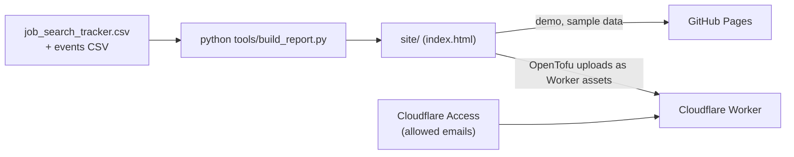

# Dashboard data pipeline

Status: implemented. The dashboard is a static site: no database, no API, no editing in the browser.

## Layers and owners

| Layer | Owner | Changes by |
|---|---|---|
| The records (applications, events) | the tracker CSV files, written by the tracker tools and Claude skills | commits to the data repo |
| The page | `tools/build_report.py`: deterministic, same input gives the same `site/` | `python tools/build_report.py [--csv FILE] [--events FILE] [--out site]` |
| Hosting | OpenTofu (`app/infra/main.tf`): Worker with the static assets, custom domain, Access application and allowed-emails policy | plan and apply (`app/DEPLOY.md`) |

Nothing is written back from the page. To change a record, change the CSV and rebuild; the next deploy replaces the site.

## Where it runs

- **Real-data deployment:** not wired into CI yet (plan step 8, needs the owner's go-ahead). The private repo that holds the real records builds `site/` with its own copy of `tools/build_report.py`; the hosting code (`app/`, OpenTofu, the workflow) lives only in this repository. With `DASHBOARD_DEPLOY` set to `true` in a repository that has the records, `deploy-dashboard.yml` builds `site/` from them and plans and applies it. Cloudflare Access is the only front door.
- **Public fork:** `deploy-dashboard.yml` only validates (tofu fmt/validate, node tests, a build from sample data). `pages.yml` publishes a demo built from `tracker/examples/events.csv` to GitHub Pages. Sample data only.
