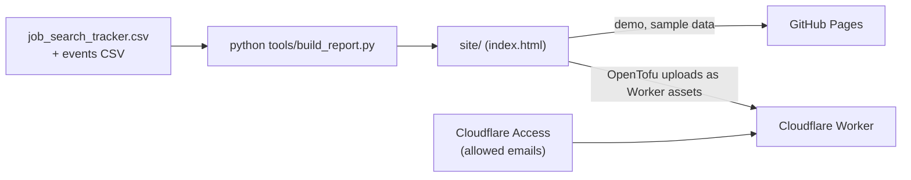

# Dashboard data pipeline

Status: implemented. The dashboard is a static site: no database, no API, no editing in the browser.

## Layers and owners

| Layer | Owner | Changes by |
|---|---|---|
| The records (applications, events) | the tracker CSV files, written by the tracker tools and Claude skills | commits to the data repo |
| The page | upstream's `tools/html_report.py`, run by `tools/build_report.py` (derives the CSV from the events log; the page is upstream's, unchanged); same input and same day give the same `site/` | `python tools/build_report.py [--root DIR] [--events FILE] [--out site]` |
| Hosting | OpenTofu (`app/infra/main.tf`): Worker with the static assets, custom domain, Access application and allowed-emails policy | plan and apply (`app/DEPLOY.md`) |

Nothing is written back from the page. To change a record, change the CSV and rebuild; the next deploy replaces the site.

## Where it runs

- **Real-data deployment:** the fork owns all of the logic and a private repository that holds the records calls it. `.github/actions/dashboard` is a composite action (checks, site build, Cloudflare preflight, plan, apply). The private repo has a thin `dashboard.yml` that checks out its own records and calls the action, pinned by commit SHA and bumped by Renovate. The records are read on the private repo's runner only, so they never reach this repository, its logs or its artifacts, and the settings (Cloudflare token or 1Password service account) stay in the private repo too. The action refuses a `data-dir` unless the calling repository is private. Why not run it here with a token to the private repo: a public repository's run logs are public, and one stray line from a build (or a validation error that quotes a row) would publish a record. Cost: the private repo's Actions minutes (about two minutes a run, only when records change). Cloudflare Access is the only front door.
- **Public fork:** `deploy-dashboard.yml` only validates (tofu fmt/validate, node tests, a build from sample data). `pages.yml` publishes a demo built from `tracker/examples/events.csv` to GitHub Pages. Sample data only.
