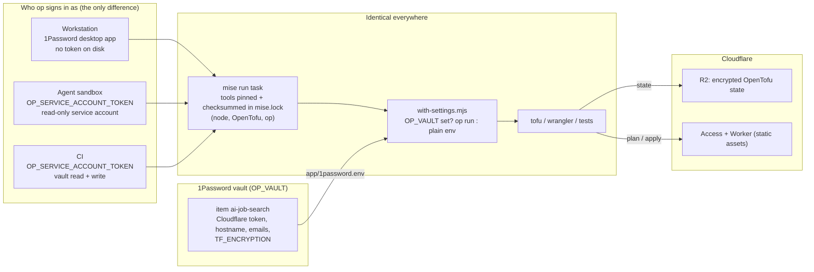

# Secrets Management

Status: implemented (dashboard).

The dashboard deploy reads its settings from **environment variables** or from **1Password**. Pick one. Each method has its own section below, so you can open only the one you use.

## Goal

One way to configure and run the dashboard deploy that behaves the same on a workstation, in an agent sandbox and in CI, follows best-practice secrets handling, and works with or without 1Password.

## The rule

Every command is a `mise run <task>`. Every task that needs settings runs through `app/deploy/with-settings.mjs`, which applies one rule:

| `OP_VAULT` | Settings come from | How |
|---|---|---|
| unset | plain environment variables (GitHub secrets in CI, `app/.env` locally) | the command runs as is |
| set | the 1Password vault `OP_VAULT` | `op run --env-file app/1password.env -- <command>` |

Both sources at once is an error, never a silent choice. If `OP_VAULT` is set and any Cloudflare setting also arrives from GitHub secrets, `app/.env` or the environment, the loader stops and the preflight names each leftover. `mise run setup --source <env|1password>` removes the other source when it switches, in GitHub and in `app/.env`, so a removed `OP_VAULT` cannot fall back to stale secrets.

## Settings

| Setting | Purpose |
|---|---|
| `CLOUDFLARE_API_TOKEN` | Cloudflare API token for OpenTofu and Wrangler. You create the first one in the dashboard, since a token can't mint itself. |
| `CLOUDFLARE_HOSTNAME` | Hostname the dashboard is served on. |
| `CLOUDFLARE_ACCESS_ALLOWED_EMAILS` | Emails Cloudflare Access lets in. |
| `TF_ENCRYPTION` | OpenTofu state and plan encryption key (one-line JSON). Generated once by setup in both methods and carried over when switching. |

## Pick your method

<details>
<summary><strong>Environment variables</strong> (no 1Password)</summary>

### Set up

```sh
cd app
mise install
mise run setup --source env
```

Setup prompts for the three Cloudflare settings and stores them as GitHub secrets, and generates the state encryption key (GitHub secret and `app/.env`). It also removes the `OP_VAULT` variable, its `.env` line and the `OP_SERVICE_ACCOUNT_TOKEN` secret if they exist.

### Where each setting lives

| Where | Set once | Set by |
|---|---|---|
| Workstation | `CLOUDFLARE_API_TOKEN`, `CLOUDFLARE_HOSTNAME`, `CLOUDFLARE_ACCESS_ALLOWED_EMAILS` in `app/.env` (git-ignored) or exported | `mise run setup --source env` / you |
| CI | the same three plus `TF_ENCRYPTION` as GitHub repository secrets | `mise run setup --source env` |
| Agent sandbox | the same three plus `TF_ENCRYPTION` as environment variables | you |

`app/.env` example:

```sh
CLOUDFLARE_API_TOKEN=...
CLOUDFLARE_HOSTNAME=dashboard.example.com
CLOUDFLARE_ACCESS_ALLOWED_EMAILS=you@example.com
```

### State encryption

Setup generates `TF_ENCRYPTION` once and stores it as a GitHub secret and in `app/.env`. Keep a copy somewhere safe: GitHub secrets can't be read back, and losing the key makes the state unreadable.

</details>

<details>
<summary><strong>1Password</strong></summary>

### Set up

Turn on the desktop app's CLI integration (Settings, Developer, "Integrate with 1Password CLI"), then:

```sh
cd app
mise install          # brings the op CLI, pinned and checksummed in mise.lock
mise run setup --source 1password
```

Setup:

1. Creates the vault (default `ai-job-search`) if it's missing.
2. Creates the item `ai-job-search` from prompts, with concealed fields, and generates `tf_encryption` once (kept on re-runs).
3. Creates a CI service account with read and write on that vault, and stores its token as the GitHub secret `OP_SERVICE_ACCOUNT_TOKEN` (skip with `--keep-service-account`).
4. Sets `OP_VAULT` as a repository variable and in `app/.env`.
5. Deletes the three Cloudflare GitHub secrets, `TF_ENCRYPTION` and their `app/.env` lines (an existing key is moved into the item first).

Re-run with `--keep-service-account` to change settings without a new service account. Check with `mise run settings`, then `mise run preflight`. To add a setting, add the field to the item and a line to `app/1password.env`.

### Where each setting lives

| Where | Set once | Set by |
|---|---|---|
| Workstation | `OP_VAULT` in `app/.env`; desktop app CLI integration on (no token on disk) | `mise run setup` / you |
| CI | variable `OP_VAULT`, secret `OP_SERVICE_ACCOUNT_TOKEN` (vault read + write) | `mise run setup` |
| Agent sandbox | `OP_VAULT` and its own read-only `OP_SERVICE_ACCOUNT_TOKEN` | you, once: `op service-account create ai-job-search-sandbox --vault ai-job-search:read_items --raw`. It can plan, and cannot store anything |

The values themselves live only in the vault. `app/1password.env` is committed and holds references, with no values and no vault name:

```sh
CLOUDFLARE_API_TOKEN=op://${OP_VAULT}/ai-job-search/cloudflare_api_token
CLOUDFLARE_HOSTNAME=op://${OP_VAULT}/ai-job-search/hostname
CLOUDFLARE_ACCESS_ALLOWED_EMAILS=op://${OP_VAULT}/ai-job-search/allowed_emails
TF_ENCRYPTION=op://${OP_VAULT}/ai-job-search/tf_encryption
```

Values exist only in the child process, and `op` masks them in output. In GitHub Actions the deploy also masks the hostname and each email.

### Identity is the only difference



### Open risks

- **Service accounts on Families:** expected to work on 1Password Families. The first `mise run setup --source 1password` confirms it.
- **Not yet run live:** `op run --env-file` with `${OP_VAULT}` in references, and CI masking of individual emails. The first PR plan run after setup exercises both.

</details>

## Decisions and why

| Decision | Why | Rejected alternative |
|---|---|---|
| A vault item plus a committed reference file | Setup creates the item from prompts, so there are no app-only steps. Adding a setting is a reviewed one-line change. | **1Password Environments.** Service accounts only read them, and they are edited in the desktop app, so generated secrets would still need a vault, giving two places. Service-account access to an Environment is fixed at creation, and the tooling is still in flux. |
| `OP_VAULT` is the switch | One variable instead of two. The mixed-source rule covers the risk a separate switch was meant to cover. | A separate source-selector variable. |
| `op` installed by mise from `mise.lock` (checksums) | The same binary on every machine, with no ad-hoc download in CI. Renovate tracks it through a custom datasource on 1Password's update feed. | `1password/load-secrets-action`, which only works in CI. |
| State and plan encryption via `TF_ENCRYPTION`, in both methods | R2 has no customer-managed keys or object versioning, so the state is encrypted client-side. It is an environment variable, so there is no code change. | Unencrypted state in R2. |
| One CI service account (vault read + write) | The preflight token check needs edit permissions, so a read-only plan identity needs a second item or vault. | Separate plan and apply identities, deferred. |

## What runs where

| Thing | Owner | Why |
|---|---|---|
| Zero Trust org, Access app and allowed-emails policy | OpenTofu | Managed as desired state. |
| R2 bucket for OpenTofu state | OpenTofu bootstrap stack (`infra/bootstrap`), applied by `deploy.mjs` only when the bucket is missing | A backend must exist before `tofu init`, so the bucket gets its own small stack: applied with local state, which then migrates into the bucket it created (the `cloudposse/tfstate-backend` pattern; that module is AWS-only and no R2 module is in wide use). State is locked with `use_lockfile`, which R2's conditional writes support. |
| The static site, the Worker that serves it, custom domain | OpenTofu (`cloudflare_workers_script` with `assets`, `cloudflare_workers_script_subdomain`, `cloudflare_workers_custom_domain`) | One plan shows page changes (through the assets manifest) and infrastructure. `site/` is built by `tools/build_report.py` before each plan; `deploy.mjs` checks it with `wrangler deploy --dry-run`. |
| The first Cloudflare API token | You, in the dashboard | A token can't mint itself. |

## Dependencies

Every dependency is pinned (hash, checksum or digest where the ecosystem allows), tracked by Renovate, and on the latest release when a change is made. Renovate runs before 6 AM on Mondays (America/Denver). Anything Renovate's managers can't see gets a custom datasource, such as the 1Password CLI.
